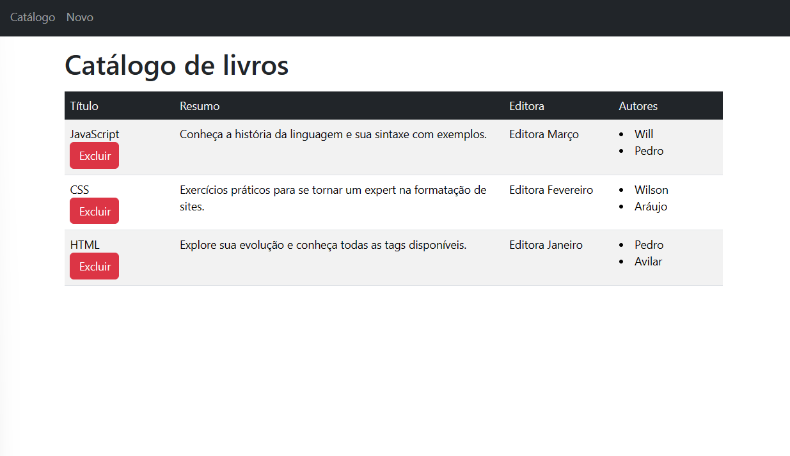
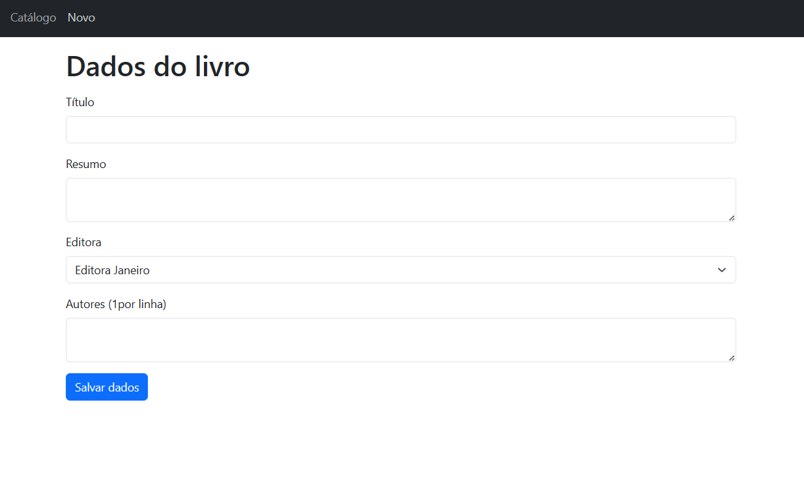
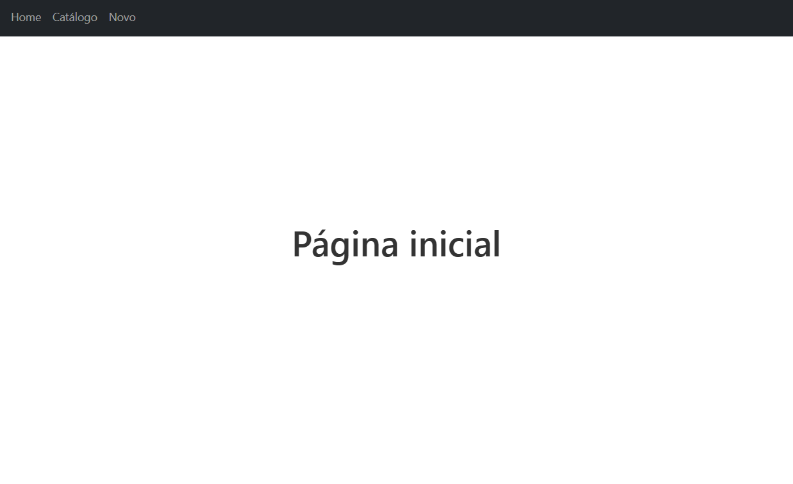
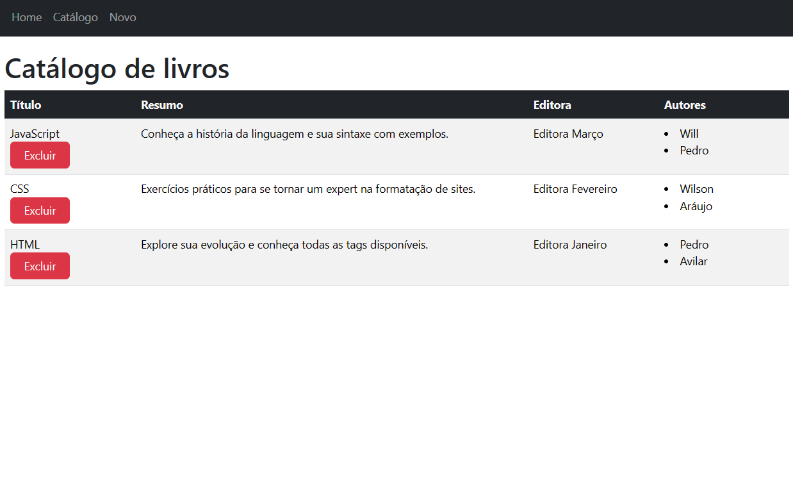
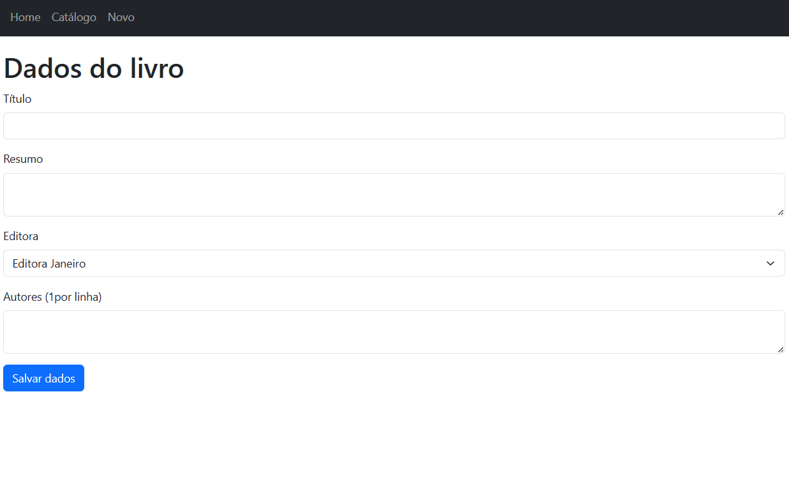

# Catálogo de Livros com React e Next.js

Missão acadêmica do curso de Desenvolvimento Full Stack da Estácio — Mundo 2, Nível 3.

**Aluno:** Lucas Alves Vieira da Silva.

O repositório reúne duas implementações de listagem e cadastro de livros com HTML, TypeScript e componentes React. A versão Next.js também inclui uma API interna em `pages/api/livros/`.

## Tecnologias e pastas

| Pasta | Dependências declaradas | Scripts disponíveis |
| --- | --- | --- |
| `livros-react/` | React 18, React Router 6, TypeScript 4, React Scripts 5 | `start`, `build`, `test`, `eject` |
| `livros-next/` | Next.js 14.2.3, React 18, TypeScript 5 | `dev`, `build`, `start`, `lint`, `test`, `test:http` |

É necessário Node.js com npm. Os manifestos não definem uma versão de Node em `engines`; valide a compatibilidade com as dependências de cada pasta.

## Executar localmente

```sh
git clone https://github.com/alvesvslucas/Mundo2-Nivel3-Estacio.git
cd Mundo2-Nivel3-Estacio
```

Para a versão React, a partir da raiz:

```sh
cd livros-react
npm install
npm start
```

Para a versão Next.js, em outro terminal a partir da raiz:

```sh
cd livros-next
npm install
npm run dev
```

Acesse o endereço informado por cada servidor. Ao executar as duas versões, escolha portas diferentes se houver conflito.

## Build e verificações

Na pasta React, use `npm run build` e `npm test`; a execução dessa versão não foi realizada nesta revisão.

Na pasta Next.js, `npm test` executa 12 testes isolados dos handlers e controles reais, com requisição/resposta simuladas. Eles passaram localmente. O workflow acrescenta instalação pelo lockfile, build e teste HTTP contra um servidor Next real; a execução local dessas etapas foi bloqueada pelo download de dependências.

Consulte [execução, verificações e limites da demonstração Next.js](livros-next/README.md). Os dados ficam em memória, sem persistência durável ou garantia entre instâncias; use apenas exemplos fictícios.

## Capturas







